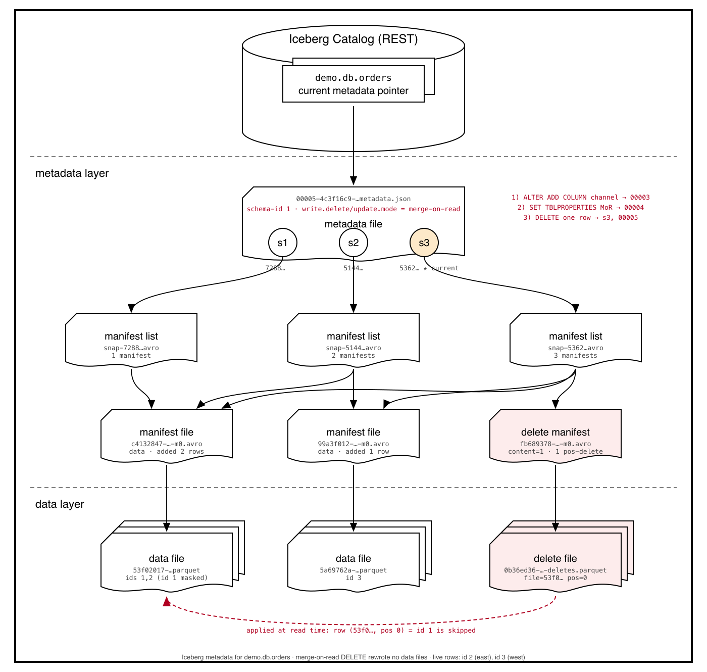

# Parquet Files, Iceberg Metadata, and Database-Like Reliability on Object Storage

*What Apache Parquet is, why it's not enough on its own, and how Apache Iceberg's metadata tree (`metadata.json` → manifest list → manifest → data file) turns a pile of Parquet files into a table with ACID guarantees. Everything below was observed in a hands-on environment (Spark 3.5 + Iceberg 1.8.1 + REST catalog + MinIO), not copied from documentation.*

---

## How to read this article

| Part | What it covers | Read it if you want to… |
|---|---|---|
| **1. The big picture** | TL;DR, the final diagram, the vocabulary | get the whole idea in five minutes |
| **2. Concepts** | Parquet, its gaps, and Iceberg's answer | understand *why* a table format exists |
| **3. Walkthrough** | Six operations on one table, with the files each one created | see *how* it works on real files |
| **4. Reliability** | ACID, mapped to what we observed | map the files to database guarantees |
| **5. Row-level changes** | Copy-on-write vs merge-on-read | choose a write strategy |
| **6. Operating it** | Production checklist, summary, reproduction steps | run it for real |
| **Appendices** | Full `docker-compose.yaml`, inspection commands | rebuild the environment |

---

# Part 1. The big picture

## 1.1 TL;DR

- **Parquet** is a columnar file format. It is excellent at storing and scanning data, but it is just a file: it has no concept of tables, transactions, or concurrent writers.
- **Iceberg** is a table format. It adds a tree of immutable metadata files on top of Parquet and one atomically-swapped pointer in a catalog. That tree is what delivers snapshots, atomic commits, isolation, schema evolution and time travel.
- A write never modifies existing files. It adds new files and then atomically moves a pointer. Readers see either the old table or the new one, never half of a write.
- **Copy-on-write (CoW)** rewrites data files on `UPDATE`/`DELETE`. **Merge-on-read (MoR)** writes small *delete files* and reconciles at read time. It's a write-cost vs read-cost trade-off.

## 1.2 The end state, in one picture

This diagram is generated from the real files in the bucket after the six operations in Part 3. Come back to it as you read; each step of the walkthrough adds one piece (`iceberg-metadata.png`):



## 1.3 Vocabulary

| Term | What it is | Example from this environment |
|---|---|---|
| **Catalog** | Service holding one pointer per table to its current `metadata.json`. The only mutable thing. | REST catalog, table `demo.db.orders` |
| **`metadata.json`** | The table's brain: schema, partition spec, properties, snapshot list. A new one is written on every commit. | `00005-4c3f16c9-….metadata.json` |
| **Snapshot** | The table's state after one commit. Points to a manifest list. | `s1 7288…`, `s2 5144…`, `s3 5362…` |
| **Manifest list** | One per snapshot. Lists the manifests that make up that snapshot. Files named `snap-*.avro`. | `snap-5362…-fb689378….avro` |
| **Manifest** | Lists individual data or delete files with partition values and column stats. Files named `*-m0.avro`. | `c4132847-…-m0.avro` |
| **Data file** | Parquet file holding rows. | `53f02017-….parquet` |
| **Delete file** | Parquet file naming rows to hide (merge-on-read only). | `0b36ed36-…-deletes.parquet` |

> **Naming note.** People often call both `snap-*.avro` and `*-m0.avro` "manifest files". They are different: the manifest *list* lets an engine skip whole manifests, and the *manifest* lets it skip individual data files.

---

# Part 2. Concepts

## 2.1 What: Apache Parquet

Parquet stores data **column by column** inside **row groups**. Each column chunk carries its own compression and statistics. A footer at the end of the file describes everything.

What we saw when we opened the Parquet files with `pyarrow`:

- **1 row group per file** (tiny data; real files hold many row groups).
- **ZSTD compression** on every column. This comes from the table property `write.parquet.compression-codec=zstd`.
- **Per-column min/max statistics in the footer**, for example `id: 1..2`, `region: east..west`, `amt: 10.0..20.0`.
- **`PARQUET:field_id` on every column** (1 to 4), plus an embedded copy of the Iceberg schema (`iceberg.schema`) in the file metadata. This is how Iceberg identifies columns regardless of name or position.
- Columns written as `not null` where the schema says so, and timestamps stored as `timestamp[us, UTC]`.

| Parquet property | Benefit |
|---|---|
| Columnar layout | Read only the columns a query projects |
| Per-column compression/encoding | Smaller files and less I/O |
| Row-group + footer statistics | Skip row groups that can't match a filter |
| Self-describing footer | Any engine (Spark, Trino, Flink, DuckDB) can read it |
| Immutable once written | Safe to cache and safe to read concurrently |

## 2.2 What Parquet does *not* give you

A folder of Parquet files has none of the following:

- No notion of "which files are the table right now": you list the directory and hope.
- No atomic multi-file commit: a job that writes 50 files and fails at file 37 leaves a half-written table that readers will happily read.
- No isolation: readers listing a directory while a writer is mid-job see inconsistent data.
- No safe schema evolution (rename/reorder breaks position- or name-based readers).
- No row-level `UPDATE`/`DELETE` without rewriting whole files by hand.
- Directory listing on object stores is slow and, historically, eventually consistent.

This is the gap Iceberg fills.

## 2.3 Why: Iceberg defines the table as a list of files

Iceberg doesn't change the Parquet files. It adds **a metadata layer that defines the table as an explicit list of files**, so the table is "the files named in the current snapshot", not "whatever is in the directory".

That one idea gives you the database properties (details and evidence in Part 4):

| Database property | How Iceberg provides it |
|---|---|
| **Atomicity** | Data and metadata files are written first, invisibly. Then a single catalog operation swaps the pointer to the new `metadata.json`. All-or-nothing. |
| **Consistency** | Every snapshot references a complete, validated set of files and a schema. A reader never sees a snapshot that is partly written. |
| **Isolation** | Readers pin one snapshot and read only the files it lists. Writers use optimistic concurrency: if the pointer moved while they were working, the commit fails and is retried or rejected. |
| **Durability** | All files are immutable objects in durable storage. Old snapshots stay readable until expired. |

---

# Part 3. Walkthrough: one table, six operations

## 3.0 Setup

Four containers: Spark (compute), an Iceberg REST catalog, MinIO (S3-compatible storage) and a one-shot job that creates the bucket. The full `docker-compose.yaml` is in [Appendix A](#appendix-a-docker-composeyaml). Start it with `docker compose up -d`, then open Spark SQL:

```sh
docker exec -it spark-iceberg spark-sql
```

The table:

```sql
CREATE NAMESPACE IF NOT EXISTS demo.db;
CREATE TABLE demo.db.orders (id BIGINT, region STRING, amt DOUBLE, ts TIMESTAMP)
USING iceberg PARTITIONED BY (days(ts));
```

(The first attempt failed with `NoSuchNamespaceException: Namespace db does not exist`. The REST catalog doesn't create namespaces implicitly, so `CREATE NAMESPACE` has to come first.)

Here is every operation we ran and the metadata file it produced. The sections below take them one by one.

| # | Operation | New `metadata.json` | New snapshot? | Section |
|---|---|---|---|---|
| 1 | `CREATE TABLE` | `00000` | no | 3.1 |
| 2 | `INSERT` (2 rows) | `00001` | **s1** `7288…` | 3.2 |
| 3 | `INSERT` (1 row) | `00002` | **s2** `5144…` | 3.3 |
| 4 | `ALTER TABLE … ADD COLUMN channel STRING` | `00003` | no | 3.4 |
| 5 | `ALTER TABLE … SET TBLPROPERTIES (merge-on-read)` | `00004` | no | 3.5 |
| 6 | `DELETE` one row | `00005` | **s3** `5362…` | 3.6 |

## 3.1 Step 1: `CREATE TABLE` creates metadata, not data

Only one file appears: `00000-….metadata.json`. It holds the schema, the partition spec (`ts_day = day(ts)`), the table location `s3://warehouse/db/orders`, and **no snapshots**, because there is no data yet. The catalog now points at it.

> **Orphan files.** The bucket contains two `00000-*.metadata.json` files because the table was created, dropped and re-created. Only one is referenced by the catalog. The other is an orphan; harmless, and cleaned up by `remove_orphan_files`.

## 3.2 Step 2: first `INSERT` builds the whole tree

```sql
INSERT INTO demo.db.orders VALUES (1,'west',10.0,current_timestamp()), (2,'east',20.0,current_timestamp());
```

Now every layer exists. Following it from the top:

**Catalog.** Stores a pointer to `00001-….metadata.json`. A commit is a compare-and-swap on this pointer: "move from `00000` to `00001` only if it still points at `00000`".

**`metadata.json`** (`00001`, then `00002` after the next insert). Contents:

- **Identity and layout:** format-version 2, table UUID, location.
- **Schema:** `id long`, `region string`, `amt double`, `ts timestamptz`, each with a stable field ID.
- **Partition spec:** `ts_day = day(ts)`.
- **Properties:** `write.parquet.compression-codec=zstd`, `owner=root`.
- **Snapshots:** each with a sequence number, a summary (`operation`, `added-records`, `total-records`, …) and a manifest-list path.
- **`current-snapshot-id`**, a `snapshot-log` and a `metadata-log` listing earlier metadata files.

**Manifest list** (`snap-7288…avro`). One row per manifest, with enough summary to prune whole manifests:

```
manifest_path        …/c4132847-…-m0.avro
content              0            (0 = data, 1 = deletes)
sequence_number      1
added_snapshot_id    7288874291000622752
added_files_count    1,  added_rows_count 2
existing/deleted_*   0
partitions[]         lower_bound=upper_bound=1f510000  (little-endian int32 = day 20767 = 2026-11-10)
```

**Manifest** (`c4132847-…-m0.avro`). One row per data file:

```
status               1   (1 = added, 0 = existing, 2 = deleted)
file_path            s3://warehouse/db/orders/data/ts_day=2026-11-10/00000-2-53f02017-….parquet
partition            {ts_day: 2026-11-10}
record_count         2
file_size_in_bytes   1280
lower_bounds         id=1, region=east, amt=10.0, ts=…
upper_bounds         id=2, region=west, amt=20.0, ts=…
null_value_counts    all 0
```

Column stats are keyed by **field ID**, not name, and bounds are stored as little-endian binary. They let an engine decide, from metadata alone, that a file cannot contain matching rows.

**Data file** (`53f02017-….parquet`). Rows `(1, west, 10.0)` and `(2, east, 20.0)`. Its Parquet footer repeats the same min/max statistics, which is the second pruning level (see 3.7).

What the writer did, in order: wrote the Parquet file, the manifest, the manifest list and the new `metadata.json`, and only then swapped the catalog pointer. Until that last step, nothing it wrote was visible to any reader.

## 3.3 Step 3: second `INSERT` reuses what already exists

```sql
INSERT INTO demo.db.orders VALUES (3,'west',30.0,current_timestamp());
```

New files: one Parquet file (`5a69762a-….parquet`, id 3), one manifest (`99a3f012-…-m0.avro`), one manifest list (`snap-5144…avro`) and `00002-….metadata.json`. The new manifest list lists **both** manifests, the old one unchanged:

| Snapshot | Manifests in its list |
|---|---|
| s1 `7288…` | `c4132847` |
| s2 `5144…` | `c4132847`, `99a3f012` |

Manifests are **shared and reused across snapshots**. A new snapshot lists the old manifests plus whatever is new, which is why commits stay cheap and old snapshots stay valid. Because s1's manifest list is untouched, you can still query the table as of s1:

```sql
SELECT * FROM demo.db.orders VERSION AS OF 7288874291000622752;  -- rows 1 and 2 only
```

## 3.4 Step 4: `ALTER TABLE ADD COLUMN` touches metadata only

```sql
ALTER TABLE demo.db.orders ADD COLUMN channel STRING;
```

Result: `00003-….metadata.json` with a second schema (`schema-id 1`, column `channel`, field ID 5) and `current-schema-id` moved to 1. **No new snapshot, manifest list, manifest or data file.** `current-snapshot-id` is still `5144…` and `last-sequence-number` is still 2.

The existing Parquet files have no field ID 5, so reading them returns `NULL` for `channel`. Iceberg matches columns by field ID rather than name or position, so no data was rewritten.

## 3.5 Step 5: `SET TBLPROPERTIES` is also metadata-only

```sql
ALTER TABLE demo.db.orders SET TBLPROPERTIES (
  'write.delete.mode' = 'merge-on-read',
  'write.update.mode' = 'merge-on-read'
);
```

Result: `00004-….metadata.json` with the two new properties. Again no snapshot. You can see the effect with:

```sql
SHOW TBLPROPERTIES demo.db.orders;
```

These properties change how *future* row-level changes are written (see Part 5).

## 3.6 Step 6: `DELETE` under merge-on-read

```sql
DELETE FROM demo.db.orders WHERE id = 1;
```

Result: `00005-….metadata.json` (now current) and a third snapshot:

- **Snapshot s3** (`5362…`): `operation=delete`, `added-delete-files=1`, `added-position-deletes=1`, `total-delete-files=1`, sequence number 3.
- **Manifest list** `snap-5362…avro` with **three** entries: the two data manifests and a new **delete manifest** (`fb689378-…-m0.avro`, `content=1`).
- **Position-delete file** `00000-6-0b36ed36-…-00001-deletes.parquet`, itself a Parquet file, with columns `file_path` and `pos` (plus the partition value). Its single row: `file_path = …53f02017….parquet`, `pos = 0`. That is the first row of that file, `id = 1`.
- **Neither data file changed.** The deleted row still physically exists in `53f0….parquet`. The summary counter `total-records = 3` still counts it. The row is subtracted only at read time, so the live table returns `id 2` and `id 3`.

| Snapshot | Manifests in its list |
|---|---|
| s1 `7288…` | `c4132847` |
| s2 `5144…` | `c4132847`, `99a3f012` |
| s3 `5362…` | `c4132847`, `99a3f012`, **`fb689378` (delete manifest)** |

## 3.7 How a read resolves, using these files

For a query against the final table:

1. Ask the catalog for `demo.db.orders` and get the current `metadata.json` (`00005`).
2. Take `current-snapshot-id` (`5362…`) and its manifest-list path.
3. Read the manifest list and drop manifests whose partition bounds can't match the filter.
4. Read the surviving manifests and drop data files whose column bounds can't match the filter.
5. Open the remaining Parquet files, prune row groups using footer statistics, and read only the projected columns.
6. Apply the delete files that target those data files.

Example: `WHERE id = 3` touches only `5a69762a….parquet`, because the other file's `id` range is 1 to 2. Nothing outside the metadata tree was listed or opened.

Two pruning levels exist at different granularities: manifest stats avoid *opening* files, Parquet footer stats avoid reading *row groups*. Here the two sets of statistics were identical, as expected.

---

# Part 4. Reliability: ACID, mapped to what we observed

## Atomicity: a commit is one pointer swap

Using step 3 (the second insert) as the example, the writer:

1. Wrote the Parquet file `00000-4-5a69….parquet` (invisible, because nothing references it yet).
2. Wrote manifest `99a3f012-…-m0.avro` and manifest list `snap-5144…avro`.
3. Wrote `00002-….metadata.json` referencing the new snapshot.
4. Asked the catalog to swap the pointer from `00001` to `00002`.

If the job dies after step 1, 2 or 3, the table is unchanged. The leftover files are harmless orphans, like the extra `00000` file in step 1.

## Consistency: schema and files move together

A snapshot is always internally complete: every file in its manifests exists, and its `schema-id` says how to interpret them. When we added `channel` (step 4), the old Parquet files were not touched, and reading them yields `NULL` for the new column. No rewrite, no downtime, and no chance of old files and new schema disagreeing.

## Isolation: snapshot reads and optimistic writes

- **Readers:** a query pins a snapshot at planning time. A writer committing mid-query changes the pointer but not the files this query already planned to read.
- **Writers:** they assume no conflict, do their work, then commit with a compare-and-swap. If another writer won, the catalog rejects the swap and Iceberg re-validates against the new base. Non-conflicting changes (e.g. appends) are retried, while real conflicts fail the commit. Sequence numbers (1, 2, 3 here) order the changes and tell engines which deletes apply to which data files.

## Durability: immutability

Every file is write-once. Snapshots s1 and s2 remain fully readable after s3 exists, so time travel is just "start from a different snapshot" (see the `VERSION AS OF` query in step 3). Old snapshots persist until you run `expire_snapshots`, at which point their unreferenced files can be deleted.

> **Caveat.** The REST fixture catalog used here is a test implementation. In production, the catalog (REST service, Glue, Nessie, JDBC) must itself be durable and must provide the atomic swap. The guarantees above are only as strong as the catalog's compare-and-swap.

---

# Part 5. Row-level changes: copy-on-write vs merge-on-read

Both strategies apply to `DELETE`, `UPDATE` and `MERGE`. They differ in *when* the cost of a row-level change is paid.

## 5.1 Copy-on-write (CoW): the default

A row-level change **rewrites every data file that contains an affected row**, producing new files without those rows (or with updated values). The old files are dropped from the new snapshot's manifests.

- Reads are fast and simple: only data files, no deletes to reconcile.
- Writes are expensive: deleting one row from a 500 MB file rewrites 500 MB.
- No delete files, so no extra compaction need for deletes.

> **Not run here.** This is documented behaviour, not something we observed. A CoW `DELETE` would write a *new* Parquet file containing the surviving rows of `53f0….parquet`, and the new snapshot's manifests would mark the old file as deleted (`status 2`) and the new file as added (`status 1`). There would be no delete manifest and no delete file. The snapshot operation is typically reported as `overwrite` (or `delete` if whole files can be dropped using metadata alone). Running the same `DELETE` on a CoW copy of the table and diffing the manifests is a good follow-up experiment.

## 5.2 Merge-on-read (MoR)

A row-level change **writes a small delete file** and leaves data files untouched. The reader combines them. Enabled in step 5:

```sql
ALTER TABLE demo.db.orders SET TBLPROPERTIES (
  'write.delete.mode' = 'merge-on-read',
  'write.update.mode' = 'merge-on-read'
);
-- 'write.merge.mode' controls MERGE INTO separately
```

What it produced is described in step 6: a delete manifest, a position-delete file and an unchanged pair of data files.

### Position deletes vs equality deletes

| | Position delete | Equality delete |
|---|---|---|
| Identifies rows by | data file path + row position | column values (e.g. `id = 1`) |
| Used by | Spark `DELETE`/`UPDATE`/`MERGE` (observed here) | Typically streaming writers such as Flink upserts |
| Read cost | Lower (targets specific files) | Higher (matched against all older data files in the partition) |

(MoR in v3 tables also supports deletion vectors. This table is format v2, so it uses position-delete *files*.)

## 5.3 Side-by-side comparison

| Dimension | Copy-on-write | Merge-on-read |
|---|---|---|
| Write amplification | High: rewrites affected files | Low: writes small delete files |
| Write latency | Higher | Lower |
| Read latency | Lowest | Higher: must apply deletes |
| Read complexity | Data files only | Data files + delete files |
| Metadata growth | New data files per change | New delete files and manifests per change |
| Small-file risk | Moderate | **High**: many tiny delete files accumulate |
| Maintenance | Expire snapshots, remove orphans | Same, **plus** regular compaction to fold deletes in |
| Best for | Read-heavy, batch updates, infrequent deletes | Frequent small row-level changes, GDPR-style deletes, CDC/upserts |
| Engine support | Universal | Reader must support v2 deletes (Spark, Trino, Flink do) |

A caution from our own data: the delete file was **1506 bytes to remove a single row, larger than the 1223-byte data file** it related to. That is Parquet footer overhead on tiny files. At this scale MoR looks wasteful, while at real scale (hundreds of MB per data file) it is the cheaper write. Don't extrapolate cost conclusions from toy data.

## 5.4 Keeping MoR healthy

Delete files must be folded back in periodically, or reads degrade:

```sql
CALL demo.system.rewrite_data_files(
  table   => 'db.orders',
  options => map('delete-file-threshold', '1')  -- rewrite any file with >=1 attached delete
);
CALL demo.system.expire_snapshots(table => 'db.orders', older_than => TIMESTAMP '2026-12-01 00:00:00');
CALL demo.system.remove_orphan_files(table => 'db.orders');
```

Monitor: delete-file count per partition, average data-file size, snapshot count, and read-latency regression.

---

# Part 6. Operating it

## 6.1 Production considerations

| Concern | Recommendation |
|---|---|
| Catalog | Use a durable catalog with true atomic swap (REST service backed by a database, Glue, Nessie, JDBC). The REST *fixture* is for tests. |
| Object store image | MinIO stopped publishing official Docker images while this environment was being built; the compose file now uses `cgr.dev/chainguard/minio:latest` (unpinned, community-maintained). Pin a digest or switch to a maintained S3-compatible store before depending on it. |
| Small files | Compact regularly. Tiny Parquet and delete files (like those here) hurt both planning and reads. |
| Snapshot retention | Schedule `expire_snapshots`. Metadata and storage grow unbounded otherwise. Retention also defines your time-travel window. |
| Orphans | Schedule `remove_orphan_files`, with a safe age threshold so in-flight writes aren't deleted. |
| Concurrency | Understand the isolation level of your engine (Spark `serializable` vs `snapshot`) and use partitioned writes to reduce commit conflicts. |
| Observability | Alert on commit failures and retries, snapshot count, delete-file ratio, and average file size. Use Iceberg's metadata tables (`.snapshots`, `.manifests`, `.files`, `.history`). |
| Schema evolution | Prefer add/rename/drop via Iceberg DDL, which is metadata-only. Never rewrite Parquet files outside Iceberg. |
| Access control | Catalog-level and object-store-level permissions together. The `admin`/`password` credentials are for local use only. |

## 6.2 Summary

| Layer | File | Mutable? | Answers the question |
|---|---|---|---|
| Catalog | pointer per table | **Yes** (atomic swap) | "Which `metadata.json` is current?" |
| `metadata.json` | `00005-….metadata.json` | No | "What's the schema, spec, properties, and which snapshots exist?" |
| Manifest list | `snap-*.avro` | No | "Which manifests make up this snapshot?" |
| Manifest | `*-m0.avro` | No | "Which data/delete files, and what are their stats?" |
| Data file | `*.parquet` | No | The actual rows |
| Delete file | `*-deletes.parquet` | No | Which rows to hide (MoR) |

Parquet makes each file efficient to read. Iceberg's metadata tree makes a *set* of files behave as one table, with atomic commits, snapshot isolation, schema evolution and time travel. And CoW vs MoR is the choice of whether row-level changes pay their cost at write time (rewrite files) or at read time (merge deletes), with compaction as the price of the latter.

---

# Appendix A. `docker-compose.yaml`

The environment has no custom Dockerfile. All four services run from public images, defined in one compose file:

```yaml
# Iceberg demo: Spark + Iceberg REST catalog + MinIO
# Based on the official Iceberg Spark quickstart.
# Start:  docker compose up -d
# Stop:   docker compose down        (add -v to wipe MinIO data)

services:
  spark-iceberg:
    image: tabulario/spark-iceberg
    container_name: spark-iceberg
    networks:
      iceberg_net:
    depends_on:
      - rest
      - minio
    volumes:
      - ./notebooks:/home/iceberg/notebooks/notebooks
    environment:
      - AWS_ACCESS_KEY_ID=admin
      - AWS_SECRET_ACCESS_KEY=password
      - AWS_REGION=us-east-1
    ports:
      - 8888:8888   # Jupyter
      - 8080:8080   # Spark master UI
      - 10000:10000 # Spark Thrift server
      - 10001:10001

  rest:
    image: apache/iceberg-rest-fixture
    container_name: iceberg-rest
    networks:
      iceberg_net:
    ports:
      - 8181:8181   # REST catalog API (try: curl localhost:8181/v1/config)
    environment:
      - AWS_ACCESS_KEY_ID=admin
      - AWS_SECRET_ACCESS_KEY=password
      - AWS_REGION=us-east-1
      - CATALOG_WAREHOUSE=s3://warehouse/
      - CATALOG_IO__IMPL=org.apache.iceberg.aws.s3.S3FileIO
      - CATALOG_S3_ENDPOINT=http://minio:9000

  minio:
    image: cgr.dev/chainguard/minio:latest
    container_name: minio
    command: ["server", "/data", "--console-address", ":9001"]
    volumes:
      - minio_data:/data
    environment:
      - MINIO_ROOT_USER=admin
      - MINIO_ROOT_PASSWORD=password
      - MINIO_DOMAIN=minio
    networks:
      iceberg_net:
        aliases:
          - warehouse.minio   # virtual-host style bucket addressing
    ports:
      - 9000:9000   # S3 API
      - 9001:9001   # MinIO web console (admin / password)

  mc:
    image: amazon/aws-cli
    container_name: mc
    depends_on:
      - minio
    networks:
      iceberg_net:
    environment:
      - AWS_ACCESS_KEY_ID=admin
      - AWS_SECRET_ACCESS_KEY=password
      - AWS_REGION=us-east-1
    entrypoint: >
      /bin/sh -c "
      until aws --endpoint-url http://minio:9000 s3 mb s3://warehouse 2>&1 | grep -qE 'make_bucket|BucketAlreadyOwnedByYou'; do echo '...waiting...'; sleep 1; done
      "

networks:
  iceberg_net:

volumes:
  minio_data:
```

| Service | Role |
|---|---|
| `spark-iceberg` | Spark SQL engine with the Iceberg runtime |
| `rest` | Iceberg REST catalog; holds the table-to-metadata pointer |
| `minio` | S3-compatible object store holding all data and metadata files |
| `mc` | One-shot job that creates the `warehouse` bucket, then exits |

> **Image note.** MinIO stopped publishing its official images (`minio/minio` and `minio/mc` on Docker Hub, `quay.io/minio/*`) while this environment was being built. The compose file therefore uses `cgr.dev/chainguard/minio:latest` and replaces `mc` with the AWS CLI for bucket creation. Both are unpinned. See 6.1.

---

# Appendix B. Reproducing the inspection

Everything above can be re-derived with a few commands.

Spark SQL (metadata tables):

```sql
SHOW TBLPROPERTIES demo.db.orders;
SELECT * FROM demo.db.orders.snapshots;
SELECT * FROM demo.db.orders.manifests;
SELECT file_path, content, record_count, lower_bounds, upper_bounds FROM demo.db.orders.all_files;
SELECT * FROM demo.db.orders.metadata_log_entries;
```

Raw files (S3 listing of the bucket, with the AWS CLI container):

```sh
docker run --rm --network iceberg-poc_iceberg_net \
  -e AWS_ACCESS_KEY_ID=admin -e AWS_SECRET_ACCESS_KEY=password -e AWS_REGION=us-east-1 \
  amazon/aws-cli --endpoint-url http://minio:9000 s3 ls s3://warehouse --recursive
```

(`iceberg-poc_iceberg_net` is the Docker network compose creates, named after the project directory plus `iceberg_net`.)

Decode Avro (manifest lists and manifests) with `fastavro`, and Parquet with `pyarrow`:

```python
import fastavro, json
for r in fastavro.reader(open("avro/metadata/snap-5362365234915553226-1-fb689378-….avro", "rb")):
    print(json.dumps(r, default=lambda o: o.hex() if isinstance(o, bytes) else str(o), indent=1))
```
